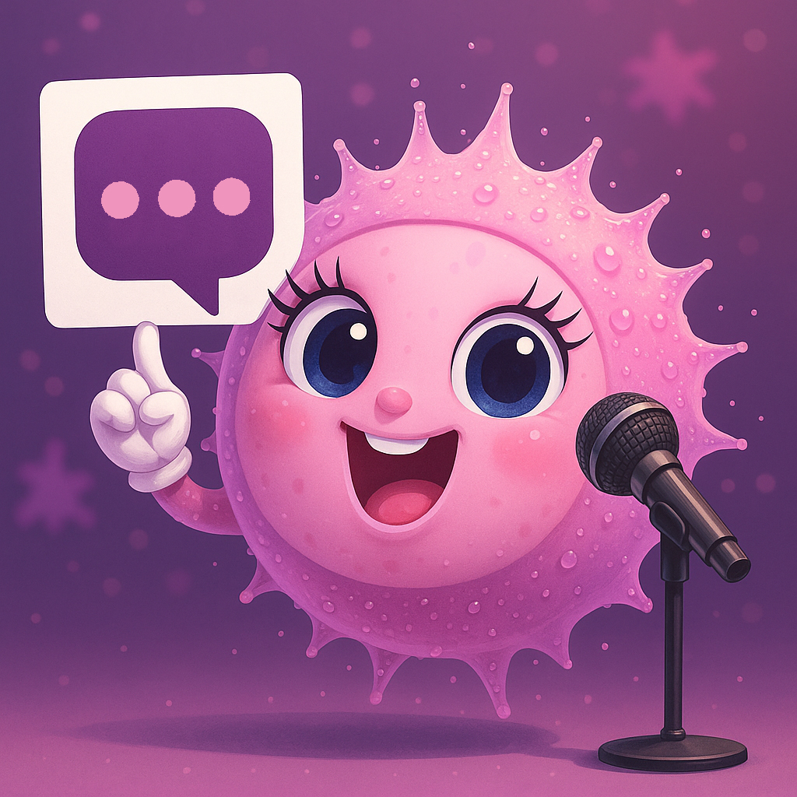
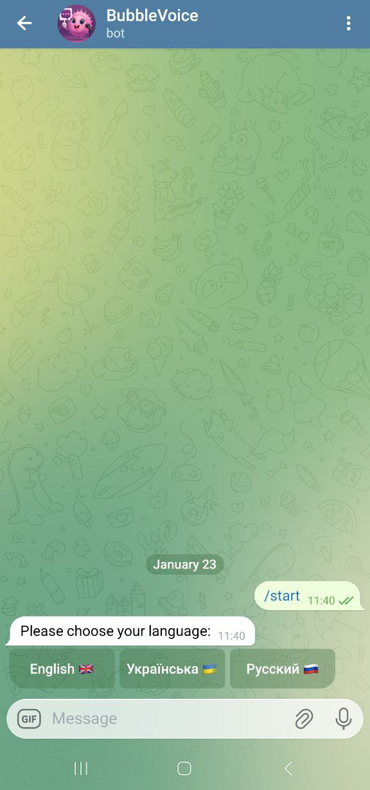
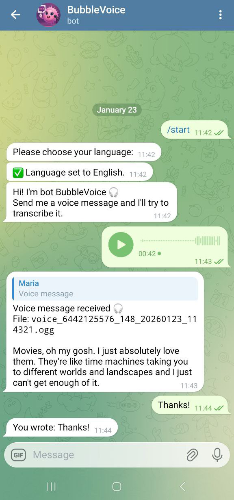

<p align="center">
  
</p>

<p align="center">
  
  
  
  
</p>

# BubbleVoice 🎧

Telegram bot that converts voice messages into text using local Whisper and ffmpeg.
Supports a multilingual interface (EN / RU / UK).

---

## Features

- 🎙️ Voice message transcription
- 🌍 Multilingual interface (English / Русский / Українська)
- 🗣️ Language selection via /start and /language commands
- 🧠 Local Whisper model (no external APIs)
- ☁️ Optional Deepgram cloud transcription backend
- 🔊 Audio conversion via ffmpeg (OGG/MP3/MP4 → WAV 16 kHz)
- ⚙️ Configurable via environment variables
- 📝 Structured logging

---

## Requirements

- Python 3.10+
- ffmpeg
- Telegram Bot Token

---

## Screenshots

<p align="center">
  
  
</p>

## Setup

### 1. Clone the repository

```bash
git clone https://github.com/machinatororis/telegram-voice2text-bot.git
cd telegram-voice2text-bot
```

### 2. Create virtual environment

```
python -m venv .venv
source .venv/bin/activate  # Linux / macOS
```
or
```
.venv\Scripts\activate     # Windows
```

### 3. Install dependencies

```
pip install -r requirements.txt
```

## Configuration (.env)

Create a ```.env``` file in the project root (it is ignored by git).

You can use ```.env.example``` as a starting point.

## Language selection and persistence

Use `/start` or `/language` to select English, Ukrainian, or Russian. The text echo and voice responses use the chosen interface language.

Language preferences are stored in SQLite at `data/user_languages.sqlite3` by default. You can override the location with `LANGUAGE_DB_PATH`. The directory will be created automatically. Local preference files are ignored by Git.

**Important for Render / container hosting:** The default filesystem is ephemeral. Without a mounted persistent disk (or an external database), saved language settings will be lost during container recreation/redeployment. Point `LANGUAGE_DB_PATH` at a persistent mounted volume to keep the same SQLite file. If your Render plan does not provide persistent storage, this local SQLite approach does **not** guarantee persistence across deployments; use an external data store for that guarantee. Multiple app replicas should use a shared database rather than separate SQLite files.

Run the language regression tests without an API token or audio dependencies:

```bash
python -m unittest discover -s tests -v
```

## Transcription backends

BubbleVoice supports multiple speech-to-text backends.
The active backend is selected via environment variables.

### Local Whisper (default)

By default, the bot uses local Whisper for transcription:

```env
TRANSCRIBER_BACKEND=whisper
```

This mode:
- Runs fully locally.
- Does not require external APIs.
- Requires ffmpeg and Whisper to be available on the system.

### Deepgram (cloud backend)

Deepgram can be used as an alternative cloud-based transcription backend.

Requirements:
- A Deepgram account.
- A valid Deepgram API key.

**Environment variables:**
```env
TRANSCRIBER_BACKEND=deepgram
DG_API_KEY=your_deepgram_api_key
```

### Required variables
```
BOT_TOKEN=your_telegram_bot_token
```

### Optional variables
```
LOG_LEVEL=INFO
```

## FFMPEG_PATH (optional)

By default the app tries to run ```ffmpeg``` from the system ```PATH```.

If you deploy to a server or use a custom ffmpeg installation, you can manually specify the path to the executable:

### Linux:
```
FFMPEG_PATH=/usr/local/bin/ffmpeg
```

### Windows:
```
FFMPEG_PATH=C:\ffmpeg\bin\ffmpeg.exe
```
If ```FFMPEG_PATH``` is set but invalid, the app will fall back to searching ```ffmpeg``` in ```PATH```.

## Run the bot (Local development — polling)
```
python main.py
```
The `main.py` file is the application entry point and initializes
logging, configuration, and bot handlers.

This mode uses Telegram long polling and is intended for local development and debugging.

## Run in cloud (Webhook mode with FastAPI)

For cloud deployments, BubbleVoice can run in **webhook mode** using FastAPI.
In this mode, Telegram sends updates to the bot via HTTP POST requests instead of long polling.

### Start the webhook server

Run the FastAPI application using `uvicorn`:

```bash
uvicorn webapp:app --host 0.0.0.0 --port 8000
```

The server exposes the following endpoints:

- `POST /webhook/<WEBHOOK_SECRET>` — receives Telegram updates when a secret is configured (otherwise `POST /webhook`)
- `GET /health` — health check endpoint for cloud platforms

This mode is recommended for:
- cloud deployments
- containerized environments (Docker, PaaS)
- platforms with limited CPU resources where long polling is inefficient

### Webhook security

For additional security, it is recommended to use a **secret webhook path**.
This helps prevent random HTTP requests from reaching the webhook endpoint.

Example:

```env
WEBHOOK_SECRET=my-super-secret-token
```

Webhook URL example:
```
https://your-domain.com/webhook/my-super-secret-token
```
In this case, Telegram will only send updates to the correct secret URL.

## Deploy to Render (Docker + Deepgram)

BubbleVoice can be deployed to Render as a Docker-based FastAPI service. The cloud version uses Telegram webhooks and Deepgram for speech-to-text transcription, so the bot can run without a local computer.

### 1. Create a Render web service

1. Push the project to a GitHub repository.
2. Open [Render Dashboard](https://dashboard.render.com/) and select **New → Web Service**.
3. Connect the GitHub repository.
4. Configure the service:
   - **Language:** Docker
   - **Branch:** `main`
   - **Instance type:** Free (if available)
   - **Dockerfile path:** `./Dockerfile`
   - **Health check path:** `/health`

The Dockerfile installs Python dependencies and ffmpeg, then starts the FastAPI application with Uvicorn.

### 2. Configure environment variables

Add these variables in **Render → Environment**:

```env
BOT_TOKEN=your_telegram_bot_token
DG_API_KEY=your_deepgram_api_key
TRANSCRIBER_BACKEND=deepgram
WEBHOOK_SECRET=your_random_secret
LOG_LEVEL=INFO
```

Generate a webhook secret using Python:

```bash
python -c "import secrets; print(secrets.token_urlsafe(32))"
```

Do not commit real tokens, API keys, or webhook secrets to Git. The `.env` and `.env.docker` files are excluded from version control.

The Docker image already includes ffmpeg, so `FFMPEG_PATH` can be left unset.

### 3. Deploy and check the service

Deploy the service and wait for the **Live** status.

Open the health check endpoint:

```text
https://your-service.onrender.com/health
```

Expected response:

```json
{"status":"ok"}
```

A `404 Not Found` response at `/` is expected because the application does not define a root endpoint.

### 4. Register the Telegram webhook

Telegram must know where to send incoming messages.

Set the webhook using the Telegram Bot API:

```text
https://api.telegram.org/bot<BOT_TOKEN>/setWebhook
```

Send a POST request with the following form field:

```text
url=https://your-service.onrender.com/webhook/<WEBHOOK_SECRET>
```

Replace the placeholders with your actual configuration values. Avoid exposing tokens and secrets in public logs, screenshots, or shared command output.

When `WEBHOOK_SECRET` is configured, the application uses `POST /webhook/<WEBHOOK_SECRET>` instead of the public `POST /webhook` endpoint.

If you change the secret, update the Render environment variable, redeploy the service, and register the new webhook URL with Telegram.

### 5. Test the bot

Send a voice message to your Telegram bot.

The expected processing flow is:

Telegram → FastAPI webhook → ffmpeg → Deepgram → Telegram transcription reply.

You can inspect application logs in the Render dashboard to diagnose processing errors.

### Free hosting limitations

Render's Free web services may spin down after inactivity. The next request can take additional time while the service starts again, which may delay Telegram webhook processing. Free hosting is therefore suitable for demonstrations and portfolio projects, but it does not guarantee instant responses or uninterrupted availability.

Deepgram usage is subject to its own pricing and account limits.

### Local development vs. cloud deployment

- **Local:** `python main.py` uses Telegram polling and can run Whisper locally.
- **Cloud:** Docker starts `webapp.py` through Uvicorn, receives Telegram webhooks, and uses Deepgram.

Avoid running polling and webhook consumers simultaneously for the same Telegram bot token.

## Notes

* ```.env``` is intentionally excluded from git.

* Use ```.env.example``` for reference.

* For server deployments, ```FFMPEG_PATH``` is recommended if ffmpeg is not in PATH.

* Audio is sent to Deepgram as 16 kHz mono WAV.

* The nova-3-general model is used with automatic language detection.

* If Deepgram returns an error or times out, the bot logs the error and automatically falls back to local Whisper without crashing.
